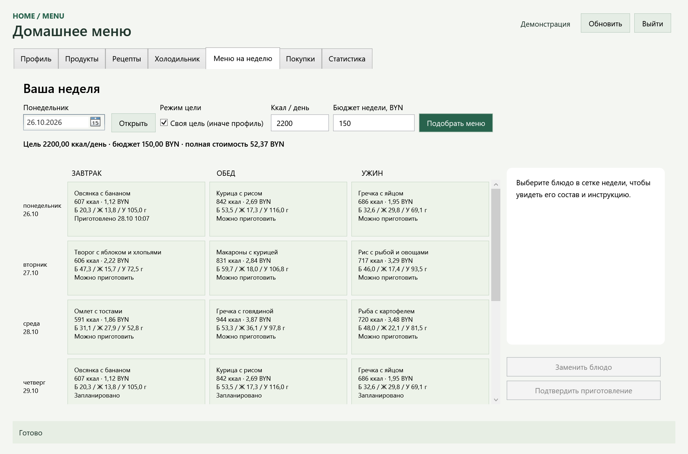

# HomeMenu

Настольная программа автоматизации составления домашнего меню. Курсовой проект Стрехи Анны Владимировны, руководитель Усенко Ф. В.

C# 12 · .NET 8 · WPF / MVVM · EF Core 8.0.24 · SQLite. Приложение работает локально, без сервера и внешних API.



## Сборка и запуск

Windows 10/11, .NET SDK с поддержкой net8.0 и .NET Desktop Runtime 8.0. Для Visual Studio 2022 установить рабочую нагрузку «Разработка классических приложений .NET» и SDK .NET 8; минимальная версия VS для базового SDK 8.0.100 — 17.8. Проверка в этой среде выполнена CLI SDK 10.0.103 и runtime 8.0.24, Visual Studio не запускалась. `global.json` намеренно отсутствует: проект не требует SDK 10.

Из корня репозитория:

```powershell
dotnet restore HomeMenu.sln
dotnet build HomeMenu.sln -c Release --no-restore
dotnet test tests/HomeMenu.Tests/HomeMenu.Tests.csproj -c Release --no-build
dotnet run --project src/HomeMenu.Wpf/HomeMenu.Wpf.csproj -c Release --no-build
```

Или открыть `HomeMenu.sln`, выбрать `HomeMenu.Wpf` стартовым проектом и запустить его.
Готовый exe после сборки: `src/HomeMenu.Wpf/bin/Release/net8.0-windows/HomeMenu.Wpf.exe`.

По умолчанию БД находится в `%LOCALAPPDATA%\HomeMenuCourse\homemenu.db`. При первом запуске применяются миграции и создаются 17 учебных продуктов и 9 рецептов. Учетные записи не создаются: нажмите «Регистрация», задайте собственные имя, логин и пароль, затем заполните профиль. Установка пакетов требует сети, работа установленного приложения — нет. Чужие локальные учетные записи имеют доступ к общим каталогам, но не к вашим запасам и планам. Защиту файла средствами Windows пользователь организует отдельно.

Для отдельной демонстрации без изменения рабочей БД:

```powershell
$env:HOMEMENU_DATABASE_PATH = Join-Path $env:TEMP 'HomeMenu-demo-2026.db'
dotnet run --project src/HomeMenu.Wpf -c Release --no-build
# После закрытия:
Remove-Item Env:HOMEMENU_DATABASE_PATH
```

Не запускайте два экземпляра для одного файла; второй получит понятный отказ. Файл не сбрасывается автоматически. Технический журнал без входных значений и паролей: `%LOCALAPPDATA%\HomeMenuCourse\errors.log`.

## Что можно делать

- Регистрироваться, входить, сохранять профиль и исключения; рассчитывать нормы питания.
- Искать и редактировать общие продукты и рецепты одной порции, вести партии с годностью.
- Генерировать меню на 7 дней / 21 прием: каждый день 90–110% цели, полная недельная стоимость в бюджете; генерацию можно отменить.
- Заменять неприготовленное блюдо, подтверждать ручное нарушение калорий/бюджета; исключения обязательны.
- Подтверждать приготовление с атомарным списанием FEFO; повторное списание запрещено.
- Рассчитывать дефицит по датам, видеть КБЖУ, отклонения, стоимость меню и закупки отдельно.

Вес — граммы, питание и цена — за 100 г, валюта — BYN. План на одного человека, три приема пищи в день. Пищевые значения и цены seed учебные; нормы не являются медицинским назначением. Разнообразие и предпочтение домашних запасов — эвристики, не гарантия глобального оптимума.

## Быстрая демонстрация

1. Зарегистрироваться; профиль: мужской, 20 лет, 175 см, 70 кг, активность 1,55, бюджет 150 BYN. Расчетная цель — 2633,0625 ккал.
2. В меню выбрать понедельник текущей недели, включить «Своя цель»: **2200 ккал**, бюджет **150 BYN**. Нажать «Подобрать меню». Для неизмененного каталога без запасов проверена стоимость **52,369 BYN**, отображается 52,37.
3. Посмотреть состав «Овсянки с бананом»: хлопья 100 г, молоко 200 г, банан 120 г; 606,8 ккал, 1,12 BYN.
4. Добавить в холодильник эти продукты с достаточной годностью, открыть меню, выбрать прошедший или сегодняшний завтрак с этим составом. Подтвердить приготовление: спишутся ровно указанные граммы.
5. Посмотреть покупки и статистику, выйти и снова войти. План и приготовление сохраняются.

Подробный маршрут, ручная замена и отрицательные проверки — [HANDOFF](docs/report/HANDOFF.md).

## Проверки и миграции

```powershell
dotnet tool restore
dotnet ef migrations list --project src/HomeMenu.Infrastructure --startup-project src/HomeMenu.Infrastructure
dotnet ef migrations has-pending-model-changes --project src/HomeMenu.Infrastructure --startup-project src/HomeMenu.Infrastructure
dotnet run --project tests/HomeMenu.UiSmoke -c Release
```

`HomeMenu.UiSmoke` — отдельная проверочная программа Windows: открывает реальные WPF Views, выполняет команды ViewModel и редакторов, проверяет bindings, отмену приготовления и повторное открытие SQLite. Работает только с новым случайным файлом в `%TEMP%\HomeMenuUiSmoke`; в основной программе нет режима обхода входа. Результат — `artifacts/ui-smoke.txt`, снимки открытых WPF-представлений — `artifacts/screenshots/`. `-- --interactive` оставляет синтетическую демонстрацию открытой.

Полная проверка: `powershell -ExecutionPolicy Bypass -File scripts/Verify.ps1` (политика меняется только для процесса скрипта). Linux/macOS: тесты Core/Infrastructure запускаются отдельно; WPF требует Windows.

Фактические результаты и границы UI-проверки — [TEST_RESULTS](docs/report/TEST_RESULTS.md). [Материалы для раздела 3](docs/report/IMPLEMENTATION.md), [карта требований](docs/report/CODE_MAP.md), [схема БД](docs/report/DATABASE.md). Word-отчет сейчас не создавался. Репозиторий: [vladgulchenko/home_menu](https://github.com/vladgulchenko/home_menu), ветка `main`. Проверенный срез кода и тестов: `eaca1373111486bccd7d6e03be66e960cd4fb828`; документация добавлена следующим коммитом.
